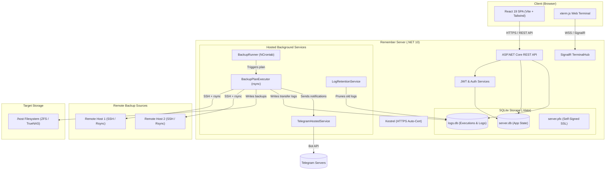
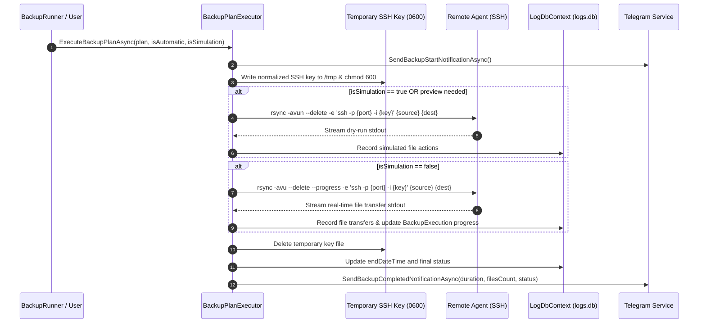

# Remote Rsync Manager — Architecture & System Design

This document details the architectural design, component interactions, data models, and runtime flows of **Remote Rsync Manager** (Remember).

---

## 1. High-Level Architecture

The system consists of a unified containerized deployment hosting a **React Single-Page Application (SPA)** and an **ASP.NET Core 10 Web API** with background hosted services and a real-time SignalR hub.

---

## 2. Component Breakdown

### 2.1 Backend Services (`src/server`)

| Component | Type | Responsibility |
| :--- | :--- | :--- |
| `Program.cs` | Bootstrap | Configures Kestrel SSL certificates, SQLite EF Core contexts, JWT auth, SignalR hubs, and SPA static file fallback. |
| `BackupRunner` | `IHostedService` | Continuously evaluates active `BackupPlan`s using `NCrontab` against current UTC time and enqueues executions. |
| `BackupPlanExecutor` | Scoped Service | Orchestrates `rsync` executions: SSH key normalization, temporary file chmod 600 handling, dry-run simulation, execution logging, and notification dispatch. |
| `LogRetentionService` | `IHostedService` | Periodically prunes historical execution logs in `logs.db` according to user-configured retention policies. |
| `TelegramService` & `TelegramHostedService` | Service / Worker | Manages Telegram bot commands, queries backup status, and dispatches real-time alerts on backup starts, completions, and failures. |
| `TerminalService` & `TerminalHub` | SignalR Hub | Establishes an interactive `/bin/bash` terminal session inside the server container and streams input/output to web clients. |
| `ExtensionRunner` | `IHostedService` | Evaluates cron expressions for active external extensions and triggers executions. |
| `ExtensionExecutor` | Scoped Service | Spawns external .NET processes in `data/extensions/{id}`, streams console output, and logs exit codes. |
| `CustomLogger` | Logging | Captures application log events and persists or streams them for administrative diagnostics. |

---

### 2.2 Dual Database Model

To prevent write contention and database locks during high-frequency file syncs (which can log tens of thousands of file entries in seconds), the system utilizes two independent SQLite databases:

#### 1. `server.db` (`DBContext`)
- **`User`**: Administrator credentials, hashed passwords, active status.
- **`Agent`**: Remote agent definitions (hostname, SSH user, port, private key).
- **`BackupPlan`**: Source path, destination path, cron schedule, status (active/inactive), agent association.
- **`CertificateConfig`**: Path and password for generated self-signed SSL `.pfx` certificate.
- **`JwtConfig`**: Secret keys and issuer metadata for signing JWT authentication tokens.
- **`AppSettings`**: General system settings (timezone, log retention threshold).
- **`Notification`**: Stored user alerts and notifications.
- **`TelegramConfig`**: Bot token, target chat ID, notification level preferences.
- **`Extension`**: External extension configuration, unpacked folder path, command, schedule, and last execution status.

#### 2. `logs.db` (`LogDbContext`)
- **`BackupExecution`**: Execution metadata (plan ID, name, start time, end time, total files to process, processed count, simulation flag, automatic flag).
- **`LogEntry`**: Fine-grained file events (execution ID, plan ID, timestamp, file name, file path, action performed e.g. `copied`, `deleted`, `ignored`, reason/details).
- **`ExtensionExecution`**: Extension execution history (extension ID, name, command, start/end time, exit code, console stdout/stderr output, status, manual vs automatic flag).
- **Indexes**: Compound indexes on `(backupPlanId, datetime)`, `(backupPlanId, startDateTime)`, and `(extensionId, startDateTime)` for rapid UI pagination and filtering.

---

## 3. Backup Execution Pipeline

---

## 4. Security Architecture

1. **Self-Signed SSL / HTTPS By Default:**
   - On first launch, `Program.cs` checks `CertificateConfig` in `server.db`. If absent, it creates a 2048-bit RSA self-signed certificate valid for 1 year, exports it as a password-protected PKCS#12 (`.pfx`) file in `./data/server.pfx`, and binds Kestrel to port 5001.
2. **Ephemeral SSH Key Isolation:**
   - Agent private keys are stored in the database. During execution, keys are written to `/tmp/ssh_key_{guid}`, permissions explicitly locked to `0600` via `File.SetUnixFileMode` and `chmod 600`, and immediately cleaned up in a `finally` block once rsync concludes.
3. **SignalR WebSocket Authentication:**
   - WebSockets cannot send standard custom HTTP headers during connection initiation. The backend JWT middleware intercepts `/hubs` requests to extract the Bearer token from the `access_token` query parameter.
4. **Directory Traversal Protection:**
   - The `FileSystemController` validates all requested directory paths to prevent `..` path traversal vulnerabilities.

